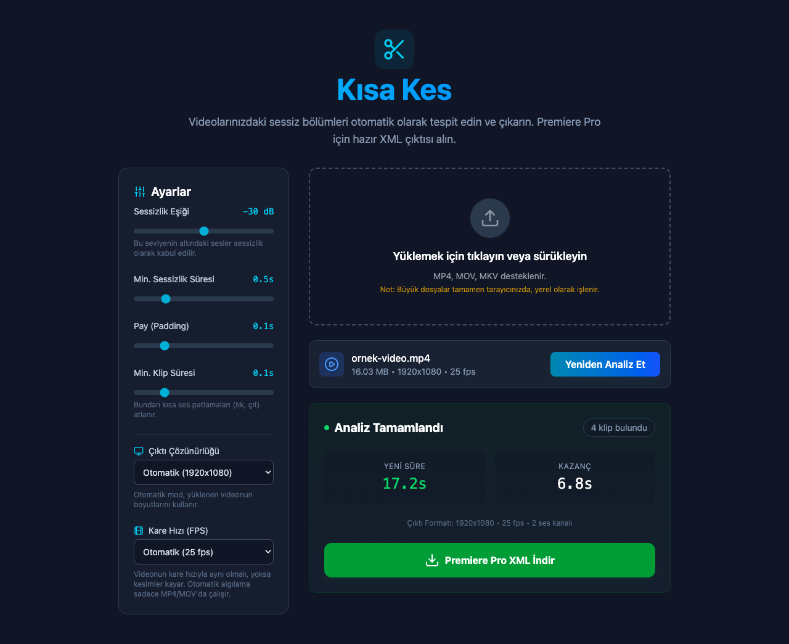

# ✂️ Kısa Kes - Otomatik Jump Cut

**Kısa Kes**, video dosyalarınızdaki sessiz bölümleri analiz eden, bu bölümleri çıkartan ve **Adobe Premiere Pro**'ya aktarabileceğiniz bir XML dosyası üreten açık kaynaklı bir araçtır.

Tüm işlem **bilgisayarınızda** gerçekleşir. Videolarınız herhangi bir sunucuya yüklenmez.



## 🌟 Özellikler

*   **Yerel Analiz:** Web Audio API ve WebCodecs ile çalışır; büyük MP4/MOV dosyaları belleğe yüklenmeden parça parça işlenir.
*   **Tüm Kanallar:** Ses tek kanalda olsa bile (ör. yaka mikrofonu) konuşma kesilmez.
*   **Hassas Ayarlar:**
    *   **Sessizlik Eşiği (dB):** Hangi ses seviyesinin altının sessizlik sayılacağını belirleyin.
    *   **Min. Sessizlik Süresi:** Ne kadar süren sessizliklerin kesileceğini seçin.
    *   **Pay (Padding):** Kesimlerin sert olmaması için konuşmaların başına ve sonuna pay bırakın.
    *   **Min. Klip Süresi:** Tık, çıt gibi kısa ses patlamalarının ayrı klip olmasını engelleyin.
*   **Premiere Pro Uyumu:** Kare hızı (23.976, 25, 29.97, 60...) MP4/MOV dosyalarından otomatik algılanır, gerekirse elle seçilir.
*   **Masaüstü Sürümü:** XML'e dosyanın gerçek yolu yazılır, Premiere'de medyayı yeniden bağlamak gerekmez.

## 📦 Kurulum

Hazır paketler **[Releases](https://github.com/US3B3/Kisa-Kes-Auto-Jumpcut/releases/latest)** sayfasındadır.

> 🔒 **İndirdiğiniz dosyayı doğrulayın:** Her sürümde `SHA256SUMS.txt` dosyası bulunur. Dosyanın değiştirilmediğini görmek için hash'ini bu listeyle karşılaştırın:
> macOS: `shasum -a 256 Kisa-Kes-Premiere.zxp` · Windows (PowerShell): `Get-FileHash Kisa-Kes-Premiere.zxp`

### 🎬 Premiere Pro Eklentisi

Premiere Pro 2020 ve sonrası, macOS ve Windows.

**Yöntem 1: ZXP (önerilen)**

1.  Releases sayfasından **`Kisa-Kes-Premiere.zxp`** dosyasını indirin.
2.  Ücretsiz **[ZXP Installer](https://aescripts.com/learn/zxp-installer/)** programını kurup açın ve `.zxp` dosyasını pencereye sürükleyin.
3.  Premiere Pro'yu yeniden başlatın ve **Pencere > Uzantılar > Kısa Kes** menüsünü açın.

<details>
<summary>Ek program kurmadan, Adobe'nin kendi aracıyla</summary>

Creative Cloud ile gelen yükleyiciyi Terminal'de (macOS) veya Komut İstemi'nde (Windows) çalıştırın. Dosya yolunu kendi indirdiğiniz yerle değiştirin:

**macOS:**
```bash
"/Library/Application Support/Adobe/Adobe Desktop Common/RemoteComponents/UPI/UnifiedPluginInstallerAgent/UnifiedPluginInstallerAgent.app/Contents/MacOS/UnifiedPluginInstallerAgent" --install ~/Downloads/Kisa-Kes-Premiere.zxp
```

**Windows:**
```bat
"C:\Program Files\Common Files\Adobe\Adobe Desktop Common\RemoteComponents\UPI\UnifiedPluginInstallerAgent\UnifiedPluginInstallerAgent.exe" /install "%USERPROFILE%\Downloads\Kisa-Kes-Premiere.zxp"
```
</details>

**Yöntem 2: ZIP ve kurulum betiği (son çare, sadece ZXP çalışmazsa)**

> ⚠️ Bu yöntem Adobe'nin `PlayerDebugMode` ayarını açar. Bu ayar sadece Kısa Kes'e değil, bilgisayardaki **tüm Adobe uygulamalarında imzasız eklentilerin** yüklenmesine izin verir. Mümkünse Yöntem 1'i kullanın. Kısa Kes'i kaldırdıktan sonra ayarı kapatmak için: macOS'ta `defaults write com.adobe.CSXS.12 PlayerDebugMode 0` (9, 10, 11 için de), Windows'ta Kayıt Defteri'nde `HKCU\Software\Adobe\CSXS.12` altındaki `PlayerDebugMode` değerini `0` yapın.

1.  Releases sayfasından **`Kisa-Kes-Premiere.zip`** dosyasını indirip açın.
2.  `install` klasöründeki kurulum dosyasını çalıştırın:
    *   **macOS:** `Mac-Kur.command` dosyasına sağ tıklayıp **Aç**'ı seçin. macOS engellerse **Sistem Ayarları > Gizlilik ve Güvenlik**'te **Yine de Aç**'a basın.
    *   **Windows:** `Windows-Kur.bat` dosyasına çift tıklayın. SmartScreen uyarısı çıkarsa **Ek bilgi > Yine de çalıştır**'ı seçin.
3.  Premiere Pro'yu yeniden başlatın ve **Pencere > Uzantılar > Kısa Kes** menüsünü açın.

> Kurulum betiği yukarıdaki ayarı açar ve eklentiyi Adobe'nin eklenti klasörüne kopyalar. Elle kurmak isterseniz `CSXS`, `jsx` ve `panel` klasörlerini macOS'ta `~/Library/Application Support/Adobe/CEP/extensions/com.kisakes.panel`, Windows'ta `%APPDATA%\Adobe\CEP\extensions\com.kisakes.panel` içine koyun.

**Kullanımı:**

1.  Timeline'da veya Proje panelinde bir klip seçin.
2.  **Premiere'de Seçili Klibi Al**, ardından **Analiz Et**'e basın.
3.  **Sekans Olarak Ekle**'ye basın. Kesilmiş hali projeye yeni sekans olarak eklenir ve açılır. Orijinal timeline'a dokunulmaz, medya otomatik bağlıdır.

> Seçili klibin kaynak dosyasının tamamı analiz edilir (timeline'daki kırpma dikkate alınmaz).

### 🖥 Masaüstü Uygulaması

| Sistem | Dosya |
|---|---|
| macOS (Apple Silicon: M1, M2...) | `Kisa-Kes-1.0.0-arm64.dmg` |
| macOS (Intel) | `Kisa-Kes-1.0.0-x64.dmg` |
| Windows | `Kisa-Kes-Setup-1.0.0.exe` |

Uygulama imzalı olmadığı için ilk açılışta uyarı çıkabilir:
*   **macOS:** Uygulamayı Programlar klasörüne sürükleyin. "Hasarlı" veya "açılamıyor" uyarısı çıkarsa **Sistem Ayarları > Gizlilik ve Güvenlik**'te **Yine de Aç**'a basın ya da Terminal'de şunu çalıştırın: `xattr -cr "/Applications/Kısa Kes.app"`
*   **Windows:** SmartScreen uyarısında **Ek bilgi > Yine de çalıştır**'ı seçin.

### 🛠 Kaynak Koddan (Geliştiriciler)

```bash
git clone https://github.com/US3B3/Kisa-Kes-Auto-Jumpcut.git
cd Kisa-Kes-Auto-Jumpcut
npm install
```

| Komut | Ne yapar |
|---|---|
| `npm run dev` | Web sürümünü tarayıcıda açar |
| `npm run electron:dev` | Masaüstü uygulamasını geliştirme modunda açar |
| `npm run electron:build` | Masaüstü kurulum dosyalarını `release/` klasörüne üretir |
| `npm run premiere:install` | Eklentiyi derler ve bu bilgisayardaki Premiere'e bağlar (değişiklikler Premiere'de paneli yeniden açınca görünür) |
| `npm run premiere:zxp` | İmzalı `release/Kisa-Kes-Premiere.zxp` üretir ([ZXPSignCmd](https://github.com/Adobe-CEP/CEP-Resources/tree/master/ZXPSignCMD) `.tools/` klasöründe olmalı; sertifika ilk seferde `~/.kisa-kes/` içine oluşturulur) |
| `npm run premiere:zip` | Kurulum betikli `release/Kisa-Kes-Premiere.zip` üretir |
| `npm test` | Testleri çalıştırır |

> npm 11 kurulum betiklerini varsayılan olarak çalıştırmaz. `electron` açılmazsa bir kez `node node_modules/electron/install.js` komutunu çalıştırın.

## 📖 Masaüstü ve Web Kullanımı

1.  **Video Yükleme:** Videoyu sürükleyip bırakın veya tıklayarak seçin.
2.  **Ayarlar:**
    *   Gürültülü bir ortamda çekim yaptıysanız **Sessizlik Eşiği**ni artırın (örn. -20dB).
    *   Konuşmaların kesilmemesi için **Pay** değerini 0.1s - 0.2s civarında tutun.
    *   Kare hızının videonuzla aynı olduğundan emin olun, yoksa kesimler kayar.
3.  **Analiz:** "Analiz Et" butonuna basın. Ayarları değiştirip "Yeniden Analiz Et" ile tekrar deneyebilirsiniz.
4.  **İndirme:** XML dosyasını indirip Premiere Pro'ya sürükleyin.

### ⚠️ Web Sürümünde Premiere'e Aktarım

Tarayıcı dosyanın konumunu bilemediği için medya "Offline" görünür:
1.  "Link Media" penceresinde **"Locate"** butonuna basın.
2.  Orijinal video dosyasını seçin.

## 🧪 Test

```bash
npm test
```

## 🛠 Teknolojiler

*   [React](https://react.dev/)
*   [Electron](https://www.electronjs.org/)
*   [Vite](https://vitejs.dev/)
*   [Tailwind CSS](https://tailwindcss.com/)
*   [MP4Box.js](https://github.com/gpac/mp4box.js)

## 📄 Lisans

[MIT](LICENSE)
